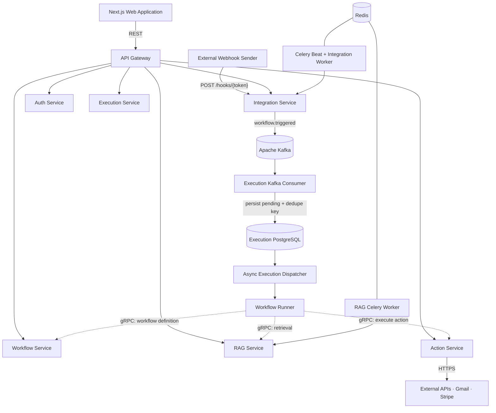
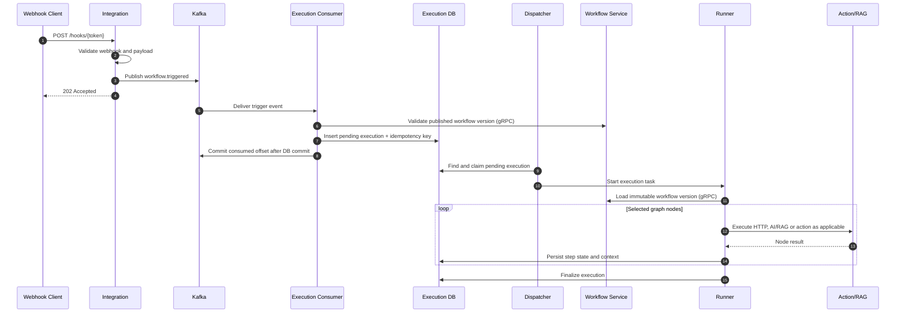
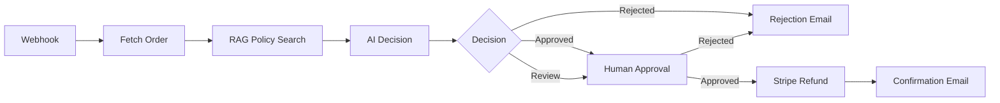
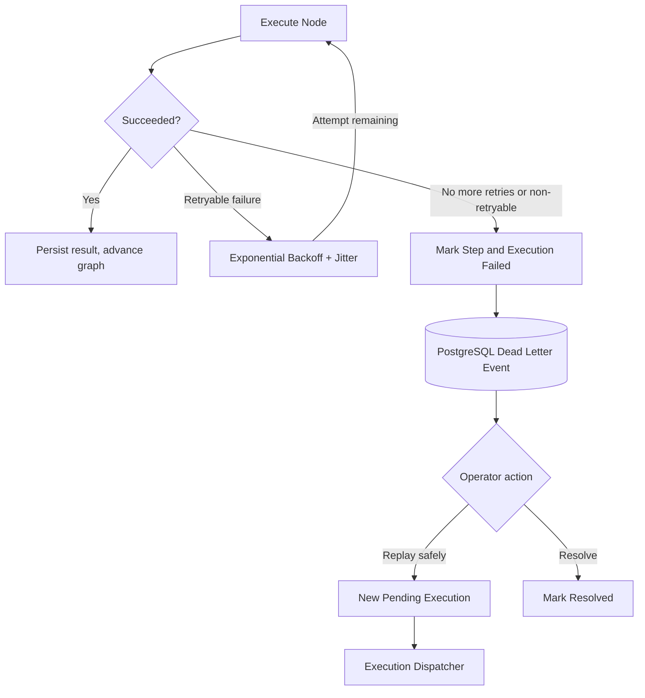

<div align="center">


### Intelligent Workflow Automation Platform

**Event → Understand → Retrieve Knowledge → Decide → Validate → Act → Observe → Recover**

[](https://www.python.org/)
[](https://fastapi.tiangolo.com/)
[](https://www.postgresql.org/)
[](https://kafka.apache.org/)
[](https://grpc.io/)
[](https://www.docker.com/)
[](https://nextjs.org/)

</div>

---

## 🚀 What is Relay?

**Relay** is a multi-tenant, event-driven workflow automation platform for processes that go beyond a simple `event → action` rule. Teams design automation graphs in a visual editor, configure integrations, publish validated workflow versions, and trigger executions through webhooks, manual runs, or schedules.

Workflows can retrieve data from external APIs, search organization knowledge with RAG, generate content, make structured AI decisions, route conditional branches, pause for human approval, and execute external actions. Each execution is tracked through its lifecycle and can be inspected or safely recovered after failures.

Relay orchestrates payment operations through payment providers such as Stripe; it does not move or hold funds itself.

## ✨ Capabilities

| Capability | Description |
|---|---|
| 🎨 **Visual workflow builder** | Node-based editor, expression mapping, workflow validation, drafts, immutable published versions |
| 🪝 **Three trigger types** | Authenticated webhooks, manual invocations, and cron-based schedules with time zones |
| 🌐 **External integrations** | HTTP requests, Gmail email delivery, and Stripe test-mode refunds through reusable connections |
| 📚 **RAG knowledge base** | Document ingestion, chunking, embedding, tenant-scoped pgvector retrieval |
| 🤖 **AI-powered nodes** | RAG Search, AI Generate, and structured AI Decision with configurable model connections |
| 🧭 **Conditional routing** | Graph-directed outcomes and team-specific branches |
| 🙋 **Human-in-the-loop** | Approve/reject decisions, paused executions, multi-stage approvals, and resumption |
| ⚙️ **Execution reliability** | Async dispatch, PostgreSQL-backed claiming, worker leases, heartbeats, retries, and idempotency |
| ♻️ **Recovery** | Execution-level dead-letter records, safe failed-node replay, resolution, and linked attempt history |
| 🔍 **Execution visibility** | Step-level statuses, attempts, duration, errors, cancellation, and historical execution groups |
| 🔐 **Workspace isolation** | Workspace-scoped access to workflows, executions, knowledge, approvals, and integrations |

## 🏗️ System Architecture

Relay consists of seven core FastAPI services. Each service owns its domain data; the API Gateway provides authenticated client access, gRPC supports internal request/response calls, and Kafka carries asynchronous workflow events. PostgreSQL persists execution state independently of the Kafka consumer, while Celery workers handle scheduled trigger processing and background document ingestion.



| Service | Domain responsibility | Persisted data |
|---|---|---|
| **API Gateway** | Client-facing API routing, authenticated identity context | — |
| **Auth Service** | Users, workspaces, credentials, sessions, JWT authentication | Users and workspaces |
| **Workflow Service** | Definitions, nodes, edges, version validation, publish/activation | Workflows and versions |
| **Integration Service** | Webhooks, ingestion, event publication, scheduled triggers | Webhooks and schedules |
| **Execution Service** | Kafka ingestion, durable execution queue, orchestration, approvals, cancellation, DLQ | Executions, steps, idempotency and approvals |
| **Action Service** | Connection management and external connectors | Integration connections |
| **RAG Service** | Knowledge bases, document processing and semantic retrieval | Documents, chunks and vector embeddings |

### Execution lifecycle



**Durable ingestion.** The Kafka consumer commits its offset only after execution persistence succeeds. The idempotency record is scoped by workspace and event key, so redelivery does not create an additional execution for the same event.

**Bounded async dispatch.** The Execution Dispatcher discovers pending rows, schedules asyncio tasks within a configurable concurrency limit, and relies on atomic PostgreSQL claims for worker ownership. Heartbeats renew short-lived leases; expired executions are marked for review rather than blindly rerunning external actions.

**Workflow version isolation.** Each execution references a published workflow version. In-flight runs and replays retain the graph version they started with, even if a new draft is published.

## 🧩 Workflow Example — Policy-Aware Refund Handling



Workflows can also support student ticket routing and academic-report emails, using external student APIs and fixed HTML templates.

## 🛡️ Reliability and Safe Recovery



- **Retries:** Up to three attempts for eligible operations, with exponential waits beginning at 2 seconds plus jitter and a configured delay cap.
- **Idempotency:** Trigger events are deduplicated using workspace-scoped keys. Provider idempotency keys protect supported financial operations.
- **DLQ:** A failed execution may produce a pending `dead_letter_events` record linking to the failed step, attempts and error.
- **Guarded replay:** A replay creates a new pending execution pointing to the original failed execution and failed node. Replay eligibility checks the starting operation and attempted downstream side effects; unsafe operations remain restricted.
- **Concurrency controls:** Local semaphore limits, database execution claims, leases and heartbeats, and transactional DLQ replay locking.
- **Human review:** Approval nodes pause executions durably and resume the appropriate branch without repeating earlier completed steps.

> External side effects can have uncertain outcomes after timeouts or worker interruption. Recovery is conservative; idempotency and provider reconciliation remain necessary for sensitive operations.

## 📊 Benchmarks and Engineering Validation

Relay includes a reproducible load-testing harness under [`benchmarks/`](benchmarks/) for exercising manual-trigger workflows and monitoring execution throughput and resource consumption.

**Benchmark setup**

- A lightweight HTTP target with endpoints that simulate **3-second and 10-second response delays**.
- Configurable request count, submission concurrency and execution concurrency.
- PostgreSQL-based collection of accepted, completed and failed executions.
- Container resource sampling for the Execution Service, Action Service, PostgreSQL, Kafka and test target.

**Measured dimensions**

| Metric | Definition |
|---|---|
| Accepted executions | Number of manual-trigger requests accepted by the API |
| Completed / failed | Terminal execution outcomes recorded in PostgreSQL |
| Throughput | Successful workflows completed per minute |
| Average / p95 latency | Time from request submission to execution completion |
| Average / p95 queue delay | Time between execution creation and start |
| Execution duration | Time between execution start and completion |
| Failure rate | Percentage of observed executions that failed |
| Resource utilization | Sampled CPU and memory use for benchmark containers |

**Validated scenarios**

| Scenario | Observed outcome |
|---|---|
| Parallel workflow execution | Multiple independent executions progressed under bounded concurrency |
| Kafka event redelivery | Replayed event ID resolved to the existing execution rather than producing duplicate work |
| Scheduled workflows | Automatic execution and email delivery verified for observed occurrences |
| Human approval chaining | Two successive approval gates resumed the same execution with the intended branches |
| Controlled HTTP failure | HTTP 503 produced a failed execution and inspectable DLQ record |
| DLQ recovery | External API changed from 503 to 200; safe replay completed from the failed node |
| Concurrent DLQ replay requests | Two simultaneous requests yielded one accepted replay and one conflict; database confirmed one linked replay |
| Stripe test-mode refund | Successful partial refund demonstrated against a test payment |
| RAG-based ticket routing | RAG, AI Decision, AI Generate and team-specific email branches exercised end to end |

The benchmark scripts generate JSON summaries and per-execution CSV files. Numeric throughput and latency claims should be read from a specific benchmark run and interpreted alongside its environment, concurrency setting and workload; no universal throughput figure is asserted here.

## 🧰 Technology Stack

| Layer | Technology |
|---|---|
| Backend | Python 3.12, FastAPI, SQLAlchemy Async, Pydantic v2, Alembic |
| Storage | PostgreSQL 16, pgvector |
| Messaging | Apache Kafka, gRPC and Protocol Buffers |
| Background tasks | Celery, Celery Beat, Redis |
| Workflow engine | Asyncio dispatcher, PostgreSQL-backed execution queue, graph runner |
| AI | OpenAI, Gemini and Anthropic-compatible BYOK connections |
| Integrations | HTTP, Gmail, Stripe |
| Frontend | Next.js App Router, React, Tailwind CSS |
| Infrastructure | Docker Compose, GitHub Actions |
| Testing | Pytest, service-level tests, end-to-end workflow and benchmark scripts |

## 📁 Repository Structure

```text
relay-workflow-automation/
├── .github/workflows/        # Service CI checks
├── benchmarks/               # Load target, request driver, resource monitor
├── frontend/                 # Next.js workflow editor and dashboards
├── proto/                    # Internal gRPC contracts
├── scripts/                  # Development helpers
├── service/
│   ├── action-service/
│   ├── api-gateway/
│   ├── auth-service/
│   ├── execution-service/
│   ├── integration-service/
│   ├── rag-service/
│   └── workflow-service/
├── docker-compose.yml
└── requirements-test.txt
```

## ⚡ Getting Started

For the audited deployment paths, start with the **[deployment guide](deploy/README.md)**: [Docker Compose](deploy/docker/README.md), [Kubernetes/K3s](deploy/kubernetes/README.md), and [verification limits](deploy/VALIDATION.md). Production deployment remains manual; these assets do not modify a running server.

### Requirements

- Docker Engine and Docker Compose plugin
- Git
- Appropriate environment credentials for integrations you choose to enable

### Run locally

```bash
# Clone the repository
git clone https://github.com/shaad4/relay-workflow-automation.git
cd relay-workflow-automation

# Fresh LOCAL development setup only; preserve existing env files on upgrades.
cp .env.example .env
./scripts/dev-up.sh

# Explicit one-time prerequisite for the fresh RAG database, then migrations.
docker compose exec -T rag-postgres sh -c 'psql -U "$POSTGRES_USER" -d "$POSTGRES_DB" -v ON_ERROR_STOP=1 -c "CREATE EXTENSION IF NOT EXISTS vector"'
./scripts/migrate.sh

# Start applications only after migrations succeed.
docker compose up -d --wait --wait-timeout 180
# Optional containerized frontend (or npm run dev in frontend/).
docker compose --profile frontend up -d --build frontend

# Inspect running containers
docker compose ps
```

The Compose stack uses root `.env` for interpolation and service-specific `.env` overrides. Existing installations should follow the [upgrade/Kafka data gate](deploy/docker/README.md) instead of overwriting credentials. Integration providers may require additional settings; never commit live secrets. No migration or reset runs automatically at application startup.

## 🧪 Tests

Backend service tests run in GitHub Actions for pull requests and pushes targeting `dev` and `main`. For a local service test environment, install both the service's dependencies and the shared test requirements, then run pytest from the service directory.

```bash
cd service/execution-service
python -m pip install -r requirements.txt -r ../../requirements-test.txt
python -m pytest tests -q
```

The benchmark driver is at [`benchmarks/relay_load_test.py`](benchmarks/relay_load_test.py); it requires a published test workflow, authenticated API access and a benchmark database connection.

## 🔭 Future Scope

Additional integrations and OAuth authorization flows, reusable workflow templates, real-time UI updates, deeper distributed tracing and broader recovery guarantees for external side effects.

## 📄 License

See [`LICENSE`](LICENSE) for the repository's license terms, if present.

<div align="center">

**Built to make intelligent automation observable, recoverable and practical .**

</div>