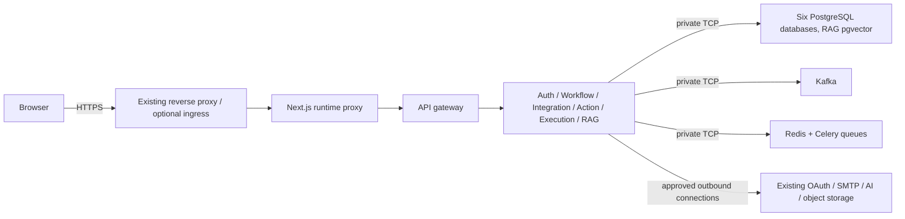

# Relay deployment operations

Relay uses the **same application images, Python/Next.js code and environment
contracts** in Docker Compose and Kubernetes. This refactor supplies deployment
assets; it does not certify the current Oracle server or perform a deployment.
The default sizing is deliberately single-node and conservative, not HA.

- [Source audit and residual risks](AUDIT.md)
- [Docker development, production and hybrid instructions](docker/README.md)
- [Kubernetes/K3s, secrets, migration Jobs and rollout instructions](kubernetes/README.md)
- [Backup and restoration](BACKUP-RESTORE.md)
- [Explicit disposable-test reset (destructive, never automatic)](RESET-TEST-DATA.md)
- [Validation evidence and remaining gates](VALIDATION.md)
- [Frontend runtime configuration](../frontend/README.md)

## Choose a topology

| Choice | Application runtime | Stateful runtime | Intended scope |
| --- | --- | --- | --- |
| Compose development | Compose; optional frontend profile or `npm run dev` | Compose volumes | Local development, synthetic credentials only |
| Compose production | Reviewed release images + production override | Existing Compose volumes | Small self-hosted installation, existing host HTTPS proxy |
| Kubernetes / K3s | Kustomize Deployments + Services | Existing external stateful endpoints, including private Compose infrastructure | Orchestration without a risky volume migration |

No manifests automatically move production volumes, install ingress/storage
controllers, create billable services, configure DNS, or modify a host firewall.
There is no automatic release publication, migration, deployment or merge in CI.

## Configuration contract

Use each `service/<name>/.env.example` as the inventory for that service. A setting
in a root Compose env file only interpolates the Compose model; it does **not**
automatically reach every container. Kubernetes uses a non-secret ConfigMap and
service-specific Secrets. Never commit real env/secret files or render live values
into CI logs; use `docker compose config --quiet`.

| Setting family | Sensitivity / scope | Guidance |
| --- | --- | --- |
| `RELAY_ENV` | Non-secret, shared | `development` or `production`; production validates secure origins/settings. |
| `FRONTEND_URL`, `BACKEND_URL` | Non-secret, public | Full HTTPS public frontend origin and callback/API base; normally backend is `https://relay.example.com/api/relay`. |
| `API_GATEWAY_URL` | Non-secret, frontend server only | Internal `http://api-gateway:8000`; never a browser Docker/K8s DNS name. |
| `*_SERVICE_URL` | Non-secret, HTTP | Internal HTTP origins, independent of gRPC addresses. |
| `*_GRPC_URL`, `GRPC_BIND_ADDRESS` | Non-secret, per service | Internal host:port targets; retain existing `AUTH_GRPC_TARGET` / `RAG_GRPC_ADDRESS` aliases. Bind default ports 50051–50056; do not publish them. |
| `DATABASE_URL` | Secret, six independent values | Existing asyncpg URL for each service's database. Percent-encode password characters. Never reuse one database across services. |
| `DB_POOL_*`, `DB_MAX_OVERFLOW` | Non-secret, per process | Keep pool budgets below database connection limits; workers may use NullPool for event-loop safety. |
| `JWT_SECRET_KEY` / `JWT_ALGORITHM` | Secret key + non-secret algorithm; shared auth/gateway | Preserve signing key during migration. Review strong HMAC secrets separately; do not silently invalidate sessions. |
| Action/AI credential-encryption keys | Secret, owning service | Preserve the **exact existing** Fernet keys and securely back them up. Do not replace them with newly generated keys on an existing installation. |
| `KAFKA_BOOTSTRAP_SERVERS` | Non-secret, integration/execution | Use reachable DNS; hybrid must also configure reachable advertised broker listeners. Preserve consumer group/topic behavior. |
| `CELERY_BROKER_URL` | Potentially secret, integration/RAG | Redis DB1 integration, DB0 RAG by default; same relevant broker for worker/Beat/API. |
| Worker/execution concurrency | Non-secret, per worker | Conservative defaults; Beat and execution deployment replicas remain 1. Increasing replicas requires safety testing, not just changing YAML. |
| Cookie/CORS options | Non-secret, auth/gateway | Explicit allowed HTTPS origins; secure cookies in production; never wildcard credentialed CORS. |
| SMTP / OAuth / Supabase / embedding credentials | Secret, feature-specific | Existing providers remain optional until feature use. No secrets in `NEXT_PUBLIC_*`, image build args or ConfigMaps. |
| User BYOK AI connections | Encrypted application data | OpenAI, Gemini and Anthropic interfaces remain unchanged; no provider calls were made during this refactor. |

The owner has confirmed the current Relay data is disposable test data. A manually
approved fresh test environment can skip preserving that data; use the separate
[reset procedure](RESET-TEST-DATA.md), not an implicit reset during normal startup.
Production safeguards remain applicable to any future real deployment.

Templates are not secret-provisioning instructions. The operator supplies existing
credentials locally and reviews any new values outside Git. K8s Secrets are
base64 representations, not encryption; restrict administrator access and review
etcd encryption/backups separately.

## Namecheap DNS / Oracle VM checklist (manual only)

1. Choose a public frontend domain, for example `relay.example.com`. In the domain's
   Namecheap **Advanced DNS** panel, an A record for `relay` should point to the
   VM's public IPv4 address. Only add AAAA if IPv6 is configured and tested. Remove
   conflicting parking/CNAME records for that hostname after reviewing existing use.
2. A separate `api.example.com` is optional, not required by the recommended
   same-origin frontend proxy. If used, configure its A record, HTTPS virtual host,
   backend callback URL, and explicit CORS/cookie policy together. Do not point
   browsers at Compose DNS or a Kubernetes ClusterIP.
3. Arrange certificates and HTTPS termination using the operator's existing
   reverse proxy/ingress process. The sample Nginx file is not automatically applied.
   Optional Kubernetes ingress requires an installed controller and a TLS Secret;
   neither LoadBalancer nor cert-manager is assumed.
4. Manually review Oracle NSG/security-list and host rules. Public access should be
   limited to intended HTTP(S) and controlled administration. Never publish database,
   Kafka, Redis, gRPC or Kubernetes API 6443 ports to the Internet.
5. K3s uses containerd; a Docker build does not make an image available to K3s.
   Import/tag images or use a registry reachable by containerd as documented in the
   Kubernetes guide. Verify amd64 vs ARM64/A1 image compatibility before migration.
6. Docker and K3s share forwarding/NAT state on the host. Diagnose CNI, node/pod
   routes, DNS and private listener reachability before changing any rules. Do not
   flush iptables or run scripts that automatically insert broad ACCEPT rules.
7. Verify actual free CPU/RAM/disk, volume mounts and backup destinations. The
   user subsequently observed running K3s system Pods and working cluster DNS;
   that does not verify application migration, ingress or TLS. Any A1 allocation
   retry process is independent of this repository change. Do not allocate paid
   resources as a workaround.

## First production release: required manual gates

- [ ] Review this branch and exact-image CI, then approve a release separately.
- [ ] Inventory old environment files and volume/project names; preserve credentials.
- [ ] Restore a recent backup into an isolated target and verify it.
- [ ] Confirm host/K3s health, architecture, disk headroom and enforceable policies.
- [ ] Prepare private runtime env files / Secrets without committing them.
- [ ] Choose immutable image tags/digests; make them available to the selected runtime.
- [ ] Verify HTTPS, public callback routes, cookie flow and provider-account cost limits.
- [ ] Configure safe private stateful connectivity if hybrid; test from an actual pod.
- [ ] Stop old schedulers/consumers before starting replacements; never two Beats.
- [ ] Review pending Alembic revisions; run each service migration once, manually.
- [ ] Verify readiness plus login/refresh/logout, workflow save/publish, synthetic
      triggers, controlled retries, approvals, delayed schedules and RAG ingestion.
- [ ] Test graceful shutdown/recovery with non-sensitive synthetic workflows and
      reconcile uncertain external side effects; do not promise exactly-once execution.
- [ ] Retain previous images and define schema-compatible rollback/recovery steps.

## Troubleshooting sequence

Check configuration **names**, selected image tags and dependency endpoints first;
do not paste secret-bearing env dumps. Inspect container/pod status, readiness,
resource pressure and internal DNS/TCP connectivity. Database readiness checks do
not prove all migrations are applied. Kafka bootstrap success does not prove the
advertised broker address is reachable. A healthy HTTP process is not a successful
end-to-end workflow. In-flight side effects require provider reconciliation after
uncertain failures; restarting/scaling is not a safe general recovery action.
