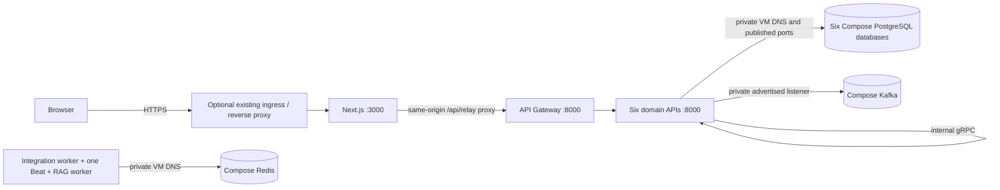

# Relay on Kubernetes / K3s

These are **reviewable deployment templates, not a verified live installation**.
No manifest applies migrations automatically, provisions infrastructure, changes
DNS/firewalls, or moves existing data. Fix an unhealthy K3s installation before
using it. Keep the working Compose application as the rollback path.

## Topology and boundaries



- Base contains seven APIs, frontend, two Celery workers and **one Beat**. One
  replica each. Execution embeds its Kafka consumer and DB-backed dispatcher;
  do not run multiple Uvicorn workers or add an HPA.
- Stateful data stays in the existing Compose volumes. Six separate database
  credentials/URLs are preserved. RAG keeps pgvector and its existing Supabase
  object storage and embedding configuration. There are no paid dependencies
  newly introduced; existing AI/embedding calls may cost money and are not part
  of deployment validation.
- No PVC or StatefulSet is needed for this topology. `/tmp` and Next's cache are
  bounded `emptyDir` scratch space, not durable data. Celery Beat's schedule file
  is scratch state; business schedules are in the integration database.
- Single-node K3s is **not high availability**. Losing the VM loses application
  availability and access to its local stateful volumes. External backups and a
  tested restore are prerequisites, not substitutes for replication.
- All service endpoints are ClusterIP. No public databases, Kafka, Redis, gRPC,
  or Kubernetes API exposure is required. Ingress is optional and not installed
  by these manifests. No LoadBalancer, cert-manager or storage provisioner is
  assumed.

## Files

| Path | Purpose |
| --- | --- |
| `base/` | Shared application workloads, DNS configuration, isolation, service account |
| `overlays/development/` | Development configuration; locally loaded `:dev` images |
| `overlays/production/` | HTTPS/secure-cookie config and intentionally invalid release-tag placeholders |
| `overlays/bootstrap/` | Production configuration with every Deployment at zero replicas |
| `migrations/` | Six explicit, separately invoked Alembic Jobs; never an application resource |
| `secrets/*.yaml.example` | Placeholder-only Secret templates, **not** included in any overlay |
| `components/ingress/` | Optional TLS frontend ingress, assuming existing K3s Traefik |

Use Kustomize v5 or a compatible `kubectl kustomize`. Render every final local
customization and run a server-side dry run against the intended healthy cluster
before an authorized deployment. Rendering alone does not validate DNS, CNI,
RBAC admission, image architecture, resource fit or application behavior.

## 1. Check prerequisites (read-only)

```bash
kubectl config current-context
kubectl get nodes -o wide
kubectl get pods -A
kubectl get storageclass
kubectl get ingressclass
kubectl get namespace kube-system --show-labels
kubectl -n kube-system get pods --show-labels
```

Confirm the correct context, all intended nodes Ready, CoreDNS functional,
containerd healthy, sufficient disk and memory, and a CNI enforcing NetworkPolicy.
Inspect existing Docker/K3s forwarding before planning any changes. Do not flush
iptables/nftables, change forwarding policy, remove Docker bridges or open cloud
ports to make a failed test pass. Host networking and security changes require
separate operator approval. K3s's Kubernetes API should remain private or behind
a controlled administrative access path.

Requests are deliberately small scheduling reservations, **not memory sizing
measurements**. Limits allow larger peaks. Add actual database, Kafka, Redis,
K3s/control-plane and operating-system usage before judging whether the VM fits;
a low-memory VM may not fit this entire stack. Measure with `kubectl top` only
if a metrics server is already available. No paid node provisioning is assumed.

## 2. Configure hybrid stateful connectivity

The Compose hybrid overlay is described in [the Docker deployment guide](../docker/README.md).
The operator must configure it before starting K3s applications. **Read the
Docker guide's existing-Kafka storage warning first**: the previous broker may
have written authoritative segments/offsets to its container filesystem rather
than the named volume. Do not recreate the broker until its actual log directory,
metadata and offline backup/restore have been verified. Hybrid connectivity is
not permission to recreate or reformat an existing Kafka broker.

Then:

1. Bind database and Redis published ports to the VM's **private interface**, not
   `0.0.0.0`. Keep existing volume names and contents. Do not mount Docker volume
   directories into K3s pods or copy a live PostgreSQL data directory.
2. Create/use stable private DNS such as `relay-infra.example.internal` resolving
   to that private interface, reachable from pods. It is an example and is not
   resolvable by default. A private node IP is acceptable as an explicit managed
   endpoint, but never use a transient Docker container IP or `localhost`.
3. The Kafka broker must advertise the private endpoint
   `PRIVATE://relay-infra.example.internal:19092` to K3s clients while retaining
   its internal `kafka:9092` listener for Compose clients. Changing only the
   client's bootstrap address is insufficient: Kafka returns advertised broker
   metadata. Controller port 9093 remains internal.
4. Replace `KAFKA_BOOTSTRAP_SERVERS` in `base/configmap.yaml`, all six database
   URLs and both `CELERY_BROKER_URL` values in private secret files. RAG uses Redis
   database **0**, integration uses **1**. URL-encode passwords in connection URLs.
5. Replace the documentation-only `192.0.2.10/32` in
   `base/network-policies.yaml` (`relay-private-infrastructure`) with the actual
   approved VM private `/32`. Add specific peers/ports if infrastructure is split
   across hosts. Do not replace it with unrestricted `0.0.0.0/0`.
6. Confirm, without changing rules, that Oracle private routing/security rules,
   host firewall, Docker forwarding and the CNI allow the pod-to-private-interface
   path. Docker publishing rules can bypass simplistic host firewall assumptions.
   **Test from a pod**, not just the host. NetworkPolicy does not replace a host
   firewall, and node-local/hostNetwork traffic behavior depends on the CNI.

| Store | Private host port in the provided Compose hybrid example |
| --- | --- |
| Auth PostgreSQL | 5434 |
| Workflow PostgreSQL | 5433 |
| Integration PostgreSQL | 5435 |
| Action PostgreSQL | 5436 |
| Execution PostgreSQL | 5437 |
| RAG PostgreSQL + pgvector | 5438 |
| Redis | 6379 |
| Kafka client listener | 19092 |

The existing Kafka/gRPC links are plaintext. This example is only appropriate on
trusted, isolated private networks. Do not span an untrusted network without an
operator-reviewed encrypted transport and corresponding client configuration.
The supplied Compose Redis has no AUTH configured; the templates deliberately use
no-password broker URLs to match it. That is acceptable only within the reviewed,
isolated private network, with access restricted to approved workloads. If an
existing Redis has a password/ACL, preserve it in the broker URL as the commented
secret-template alternative shows; do not add a password to the client URL
without configuring the server. This refactor does not enable/rotate Redis AUTH.
Redis authentication does not encrypt traffic. PostgreSQL TLS can be configured
with driver-supported options where the server has trusted TLS certificates.

The default policy allows internal Relay HTTP/gRPC, CoreDNS in `kube-system`,
approved private stateful ports, public provider HTTP/HTTPS for the relevant
workers/services, and auth SMTP port 587. IPv4 private/link-local destinations,
including metadata addresses, are excluded from generic public egress. Private
HTTP workflow targets, SMTP465, alternative provider ports, IPv6, custom DNS,
NodeLocal DNSCache and alternative CNI/controller labels require a narrow,
reviewed policy adjustment. Standard NetworkPolicy cannot implement DNS-domain
allowlists. Do not claim this policy alone prevents every SSRF or node escape.

## 3. Build and select the same images as Compose

Build with the repository Dockerfiles using a release tag/commit, on the target
architecture or using Buildx's `--platform linux/amd64,linux/arm64` and a registry
supporting manifests. Do not start the stack merely to build images. Follow
[Docker instructions](../docker/README.md) for build commands and validation.

In both `overlays/production/kustomization.yaml` and
`migrations/kustomization.yaml`, replace every `REPLACE_WITH_RELEASE_TAG` image
with the exact tested release. Prefer immutable digests using Kustomize's
`digest:` field (remove `newTag:`). Use the **same six service image digests for
migrations and applications**; frontend/gateway have no migrations. A private
registry additionally needs a separately authorized pull secret and
`imagePullSecrets` configuration. No registry account is provisioned here.

For a local K3s node, Docker's images are **not** automatically present in
containerd. After authorized builds, an operator can import the target-architecture
images (replace the tag):

```bash
docker save -o /tmp/relay-images.tar \
  relay/api-gateway:RELEASE relay/auth-service:RELEASE \
  relay/workflow-service:RELEASE relay/integration-service:RELEASE \
  relay/action-service:RELEASE relay/execution-service:RELEASE \
  relay/rag-service:RELEASE relay/frontend:RELEASE
sudo k3s ctr images import /tmp/relay-images.tar
sudo k3s ctr images list
```

Import to **every eligible node**, or use a reachable registry. `IfNotPresent`
avoids unnecessary pulls, but never reuse a mutable production tag. This is a
manual image import, not proof that a container ran successfully. See
[K3s image import documentation](https://docs.k3s.io/add-ons/import-images).

## 4. Prepare secrets without changing existing credentials

Keep the current JWT signing secret shared between auth and gateway. Keep the
existing action and AI Fernet keys unchanged: changing them without a dedicated
migration makes stored integration/BYOK credentials unreadable. Do not generate
new credentials just because deployment method changes.

Copy the seven `.yaml.example` templates to a private directory **outside the
repository**, with restrictive permissions. Replace every required placeholder
through the operator's approved secret-management process; remove unused optional
Google OAuth fields instead of leaving fake values. Never commit filled copies,
include secrets in shell command arguments, paste them into tickets, or print
rendered Secret manifests in CI. No secret file is created automatically.

Templates use separate service Secrets plus one `relay-jwt` Secret. Only services
that need the JWT receive it. Migration Jobs receive only their own database URL,
not SMTP, provider or encryption secrets. Kubernetes Secrets are not encrypted
merely because values are base64 encoded; enable appropriate datastore encryption
and restrict operator read access using cluster procedures. The app's service
account has no RBAC grants and no mounted API token.

Production `FRONTEND_URL` must be the real HTTPS origin.
`BACKEND_URL=https://relay.example.com/api/relay` uses the frontend's same-origin
runtime proxy. Set the existing non-secret SMTP host/from address, `GOOGLE_CLIENT_ID` and
`SUPABASE_URL` in the ConfigMap when those features are enabled. Set
`GOOGLE_REDIRECT_URI` and `GOOGLE_GMAIL_REDIRECT_URI` to their
full proxy callback paths as shown in the production config patch and register
those exact values at the provider. Frontend receives only non-secret config;
`API_GATEWAY_URL=http://api-gateway:8000` stays server-side. No `NEXT_PUBLIC_*`
secret injection or environment-specific frontend rebuild is needed.

## 5. Bootstrap and migrate — manual, maintenance window

Back up and prove restore first; see [backup instructions](../README.md).
Coordinate one operator/release. Quiesce external webhooks and schedules, allow
in-flight executions/ingestion to drain, and stop the old Compose application
workers/Beat **without stopping or deleting its databases/brokers/volumes**.
There must never be a Compose Beat and K3s Beat publishing concurrently. Fence
an unreachable old host before replacing it; do not assume a failed health check
proves its processes stopped.

Review all existing Alembic revisions, including pgvector extension requirements
for the RAG database. Do not grant broad production superuser access to application
pods. If extension installation needs DBA privileges, arrange that explicit
operator prerequisite separately. **The `pgvector/pgvector` image supplies
extension files, but does not create the extension inside the RAG database.**
Before any migration Job, an authorized database administrator must enable it in
the *actual database named by the RAG service's `DATABASE_URL`* (not automatically
assumed to be the database currently named by a container's `POSTGRES_DB`). For
Compose-hosted PostgreSQL, after verifying the target and existing admin access,
replace both placeholders and run manually:

```bash
docker compose exec -T rag-postgres psql \
  -U RAG_DATABASE_ADMIN -d ACTUAL_RAG_DATABASE -v ON_ERROR_STOP=1 \
  -c 'CREATE EXTENSION IF NOT EXISTS vector;'
docker compose exec -T rag-postgres psql \
  -U RAG_DATABASE_ADMIN -d ACTUAL_RAG_DATABASE -v ON_ERROR_STOP=1 \
  -c "SELECT current_database(), extname FROM pg_extension WHERE extname = 'vector';"
```

Use existing protected admin authentication, not a password in shell arguments.
For externally managed PostgreSQL, use that database's approved admin connection
instead. Stop if the extension is unavailable or the database identity is wrong.
The application and migration Jobs never create this extension or promote their
role to superuser. No Alembic history/schema change is introduced by this refactor.

```bash
# Validate/render locally. These files contain no Secret resources.
kustomize build deploy/kubernetes/overlays/bootstrap > /tmp/relay-bootstrap.yaml
kustomize build deploy/kubernetes/overlays/production > /tmp/relay-production.yaml
kustomize build deploy/kubernetes/migrations > /tmp/relay-migrations.yaml
# Authorized maintenance only. Namespace creation is separate so the
# server-side dry run can validate namespaced resources on a fresh cluster.
kubectl apply --dry-run=server -f deploy/kubernetes/base/namespace.yaml
kubectl apply -f deploy/kubernetes/base/namespace.yaml
kubectl apply --dry-run=server -f /tmp/relay-bootstrap.yaml
# All application replicas remain zero.
kubectl apply -f /tmp/relay-bootstrap.yaml
# Use only the completed, private operator directory, never the .example files.
kubectl apply -f "$HOME/.config/relay-secrets/"

# The jobs below do not run on ordinary application apply/rollout.
kubectl create -f /tmp/relay-migrations.yaml
for service in auth workflow integration action execution rag; do
  kubectl -n relay wait --for=condition=complete \
    "job/${service}-service-migrate" --timeout=600s || exit 1
done
# Inspect statuses; examine failed job logs privately (database errors may contain details).
kubectl -n relay get jobs

# Only after every migration succeeds and the old workers are stopped:
kubectl apply --dry-run=server -f /tmp/relay-production.yaml
kubectl apply -f /tmp/relay-production.yaml
kubectl -n relay rollout status deployment/frontend --timeout=900s
kubectl -n relay rollout status deployment/api-gateway --timeout=900s
kubectl -n relay rollout status deployment/execution-service --timeout=900s
kubectl -n relay get deployments,pods,services
```

Do not use `kubectl apply` to repeat completed migration Jobs: Jobs are immutable
and cannot be treated as recurring startup hooks. Before a later release, retain
migration evidence and remove **only completed named Jobs** if their 24-hour TTL
has not cleaned them up. Confirm no migration is running; update Job images to
the new release, then `kubectl create` once. Never delete namespaces, PVCs or
volumes as a migration retry. `backoffLimit: 0` makes failed migrations visible
instead of silently retrying potentially partial DDL. Diagnose, restore/test as
necessary, and obtain operator approval before a retry.

## 6. Verify before opening traffic

Port-forward the frontend for a development smoke check (development overlay
uses `http://localhost:3000` and insecure local-development cookies):

```bash
kubectl -n relay port-forward service/frontend 3000:3000
# In another terminal:
curl --fail http://localhost:3000/health
curl --fail http://localhost:3000/ready
```

For production, test through the real approved HTTPS endpoint: auth signup/login,
refresh/logout cookie scope, email verification/reset and enabled Google OAuth;
workflow save/publish, manual trigger, webhook signature validation, one scheduled
trigger, execution history/recovery and human approval. Test BYOK connections and
RAG only with explicitly authorized provider use and non-production data. Verify
that refresh cookies work through `/api/relay/auth` and that cross-origin
credentialed writes are rejected. No WebSocket application endpoint currently
requires a separate Kubernetes Service; configure ingress upgrade support if one
is added later rather than publishing internal services.

`/health/live` on APIs is process-only; `/ready` checks the DB, and execution also
checks its consumer/dispatcher tasks. Execution liveness deliberately uses its
existing `/health` endpoint so an irrecoverably terminated background task causes
a restart instead of remaining unready forever; transient DB failure alone does
not trigger this liveness probe. A healthy pod does not prove Kafka topic
correctness, correct schemas, provider credentials, SMTP delivery or full workflow
success. Frontend `/health` is process-only and `/ready` checks gateway readiness.
Celery worker probes ping **that worker's own node**, not any worker on the broker;
Beat readiness checks its PID file, not scheduler correctness. Inspect the actual
last scheduled execution to establish scheduling health. No liveness probe kills
a slow in-flight Celery task merely because a provider/broker is slow.

## 7. Optional HTTPS ingress

The optional component assumes an **existing** Traefik ingress controller in
`kube-system`, labeled `app.kubernetes.io/name=traefik`, and an operator-provided
TLS Secret `relay-tls`. Verify the running controller labels and CNI handling.
Change the class, source policy selectors and host for NGINX or another controller.
Add this to the production overlay only after preparing the controller and TLS:

```yaml
components:
  - ../../components/ingress
```

All traffic goes to frontend; `/api/relay` proxies gateway requests at runtime.
The gateway and gRPC services remain internal. Obtain/renew a certificate using
existing approved processes; cert-manager is optional and not installed here.
If a host reverse proxy is preferred, design a reviewed private upstream route;
ClusterIP is not a host-port promise. The provided ingress only grants the
verified ingress-controller pods access, not arbitrary namespace ingress.

Set Namecheap A/AAAA records only after verifying the approved public entrypoint
and HTTPS readiness; no DNS or Oracle security-list change is performed by this
repository. An AAAA record requires a tested IPv6 path and policy. Expose only
required 80/443 at the approved edge, never 543x/6379/9092/19092/5005x/6443 publicly.

## Updates, shutdown and rollback

- Keep one replica and one process for execution and Beat. Recreate prevents
  normal rollout overlap; it is **not a distributed singleton lock** and does not
  fence network-partitioned nodes. Do not force-delete a pod as proof that its
  worker stopped. See [Deployment strategy behavior](https://kubernetes.io/docs/concepts/workloads/controllers/deployment/).
- Default worker concurrency is `CELERY_WORKER_CONCURRENCY=1`; execution concurrency
  is two. Change only after resource, idempotency and failure testing. RAG permits
  up to 660-second tasks and gets 720 seconds termination grace. Execution waits
  for active work but has a finite 180-second pod grace; drain before updates.
  Forced termination can leave ambiguous external effects requiring reconciliation,
  not automatic replay. Recovery/leases/approval semantics are unchanged.
- For a new release: back up, review migrations, quiesce/drain, apply bootstrap
  (zero replicas), migrate once, apply production, check all rollouts and behavior,
  then reopen traffic. This small-server strategy intentionally allows downtime.
- Shut down application workloads with the bootstrap overlay; leave external
  stateful infrastructure and persistent volumes running. Do not delete namespace
  or use Compose `down -v` as a shutdown method.
- Roll back by reapplying the previously recorded **application image digests and
  matching non-secret configuration**. `kubectl rollout undo` rolls back a pod
  template only; it does not restore ConfigMaps, Secrets or DB schemas. Determine
  schema compatibility first. Never blindly run Alembic downgrade against live
  data. A restore uses a verified backup and an approved recovery window.
- After modifying a ConfigMap/Secret, pods do not reread env automatically. Drain
  and perform a controlled restart (especially workers/Beat); validate again.

## Troubleshooting and verification limits

| Symptom | Check without changing live policy |
| --- | --- |
| ImagePullBackOff | Exact tag/digest, target CPU architecture, registry access, import on every node |
| Pending | Resource reservations, admission errors, node readiness/taints, disk pressure |
| CrashLoopBackOff | Missing required env names, migration status, private DNS, Kafka advertised metadata |
| API not Ready | Database reachability/schema, credentials privately, execution background tasks |
| Celery not Ready | Correct Redis db/password, worker hostname, queue names, one Beat only |
| Ingress timeout | Controller labels/class/TLS, NetworkPolicy implementation, ready frontend endpoints |
| OAuth/refresh fails | Public proxy callback URI, HTTPS, exact FRONTEND_URL, host-only cookie path |
| Private endpoint timeout | CNI route/NAT + Docker forwarding + host/cloud policy; do not flush rules |

Use `kubectl describe` and narrowly scoped pod logs privately. Do not dump Secret
resources or `env` output. Kustomize renders and static checks are necessary but
insufficient: a healthy target cluster, image runs on its architecture, network
policy enforcement, migration dry run/restoration, end-to-end workflows and TLS
must still be verified by the operator. [Kubernetes NetworkPolicy limitations](https://kubernetes.io/docs/concepts/services-networking/network-policies/)
are particularly relevant when Docker and K3s share a host.
